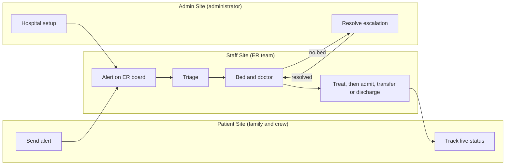

# Emergo

**Every emergency, coordinated.**

Emergo is a three-site emergency coordination system that connects ambulance crews, families and hospital ER staff on one live data layer. It was built for the Mehran University (Khairpur) hackathon as a working HTML, CSS and JavaScript prototype.

> **Prototype notice.** Emergo is a student prototype. It is not a medical device, it does not diagnose, and it must not be used with real patient data. All data stays in your browser's `localStorage`.

## The problem

Our hackathon problem statement:

> During emergencies, hospital staff may struggle to coordinate patient priorities, available beds, doctors, and ambulances when information is scattered across different systems.

In many hospitals that information lives in paper registers, phone calls and chat groups. Emergo puts it on one board.

## Who it is for

The patient is never the user. A person in a medical emergency cannot operate an app, so Emergo is built for the people around them:

| Site | Folder | Used by | Purpose |
| --- | --- | --- | --- |
| Patient Site (Family & Ambulance Portal) | `/patient` | Ambulance crews, family members | Send a pre-arrival alert, get a tracking code, follow live status |
| Staff Site (ER Dashboard) | `/staff` | Triage nurses, bed managers, doctors | Live ER board, triage, bed and doctor matching, status updates, escalation |
| Admin Site (Setup & Oversight Console) | `/admin` | Hospital administrator | Set up wards, beds, doctors and staff; resolve escalations; overview, analytics, audit log |

**Build status** (update before submission):

| Site | Status |
| --- | --- |
| Patient | Built. Live demo: https://emergo.site.je/?i=1 |
| Staff | In progress |
| Admin | In progress |

## How it works



**Example: a road accident**

1. The ambulance crew submits an alert from the Patient Site (four required fields, built for under 30 seconds).
2. The alert appears on the Staff Site board with an ETA countdown, and the family receives a tracking code.
3. A nurse acknowledges it. The family's tracking page updates.
4. The patient arrives. The nurse triages, and the system suggests a severity level that the nurse confirms or overrides.
5. A bed is reserved and an on-duty doctor is assigned.
6. The doctor treats the patient, then admits, transfers or discharges. The family sees the ward or destination hospital.
7. If no bed is free, staff raise an escalation and the administrator approves a transfer or redirects.

## Features

**Patient Site**
- Alert form for ambulance crews and families, with large touch targets and a short list of required fields.
- Tracking code plus phone-digit check, with a live status timeline.
- Families see status, ward and transfer hospital only. Severity, vitals, doctor and bed are never shown.
- Duplicate-alert guard, ETA update and cancel before arrival, draft autosave.

**Staff Site**
- Live ER board: incoming alerts, patients in the ER sorted by severity, closed cases.
- Triage with a suggested severity (nurse decides), five-level scale.
- Bed and doctor matching, bed lifecycle (available, reserved, occupied, cleaning).
- Walk-in registration, escalation when no bed is free, mass casualty mode.
- Role-based actions and a full audit log.

**Admin Site**
- Setup wizard for hospital details, wards, beds, doctors and staff accounts.
- Escalation inbox with a limited case summary.
- Live overview of beds and cases, and five analytics KPIs.
- Audit log viewer, JSON export and import, seed data and reset tools.

## Tech stack

- HTML5, CSS3 and vanilla JavaScript. No frameworks, no build step, no CDN dependencies.
- `localStorage` as the database, accessed only through the shared data layer in `/shared`.
- Live updates across tabs using the browser `storage` event, with a 5-second polling fallback.
- Colour palette: forest sage `#5C7057`, sage `#89A482`, light sage `#ACC5A6`, mint `#D1EDD3`.

## Run it locally

You need a modern browser (Chrome or Edge recommended) and any static file server. Do not open the files with `file://`, because the three sites must share one origin to share data.

```bash
git clone https://github.com/StudentFaizan7426/emergo.git
cd emergo
npx serve .
```

Then open the address shown in the terminal. You can also use the VS Code Live Server extension.

**Try the full flow (same browser, three tabs):**

1. Open `/admin/` and load the seed data from the Data tools page. Demo logins are defined in `shared/seed.js`.
2. Open `/staff/` in a second tab and log in as a triage nurse.
3. Open `/patient/` in a third tab and send an alert.
4. Watch the alert appear on the Staff board, then move it through acknowledge, arrive, triage, bed and doctor, treatment and admit.
5. Switch back to the Patient tab and open the tracking page with your code to see each status change.

## Project structure

```
emergo/
├── index.html          Landing page linking the three sites
├── README.md
├── LICENSE
├── .gitignore
├── shared/             Data layer used by all three sites
│   ├── constants.js    Status values, categories, severity labels
│   ├── storage.js      The only code that touches localStorage
│   └── seed.js         Demo wards, beds, doctors, staff, config
├── patient/            Family & Ambulance Portal
├── staff/              ER Dashboard
├── admin/              Setup & Oversight Console
└── docs/
    ├── DATA_CONTRACT.md
    ├── PRD-patient-site.pdf
    ├── PRD-staff-site.pdf
    └── PRD-admin-site.pdf
```

Adjust this tree to match your actual folders before publishing.

## Documentation

- [Data contract](docs/DATA_CONTRACT.md): storage keys, field ownership and write rules shared by all three sites.
- Product requirements: [Patient Site](docs/PRD-patient-site.pdf), [Staff Site](docs/PRD-staff-site.pdf), [Admin Site](docs/PRD-admin-site.pdf).

## Known limitations

- **Single browser only.** `localStorage` is private to one browser and one origin, so a case created on a phone will not appear on another device. The demo runs all three sites in one browser.
- **Demo-grade access control.** Accounts and PINs are stored in plain text in `localStorage`. This is role-based access for demonstration, not security.
- **Severity suggestions are not clinically validated.** They are a starting heuristic. The nurse always decides.
- **Ambulance location is not tracked.** Crews enter an ETA by hand.
- Two staff editing the same case can still conflict. Guarded writes reduce the risk but do not remove it.

## Roadmap

- Replace `localStorage` with Firebase or Supabase for real multi-device sync and authentication.
- Live ambulance location and nearest-hospital suggestion.
- SMS or WhatsApp notifications for families.
- Urdu language support.
- Clinical review of the triage suggestion rules.

## Team

- Muhammad Faizan Jamro
- [Add teammate names]

Built for the Mehran University of Engineering and Technology (Khairpur) hackathon.

## License

Released under the [MIT License](LICENSE).
